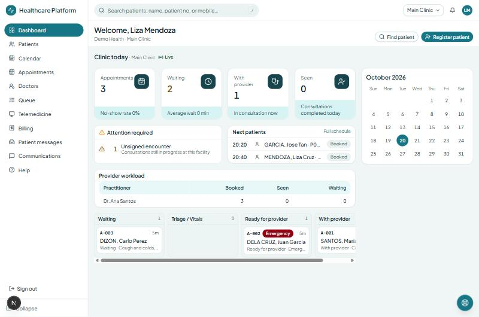
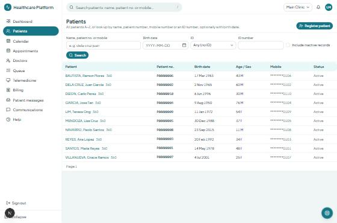
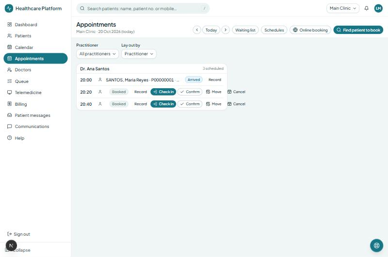
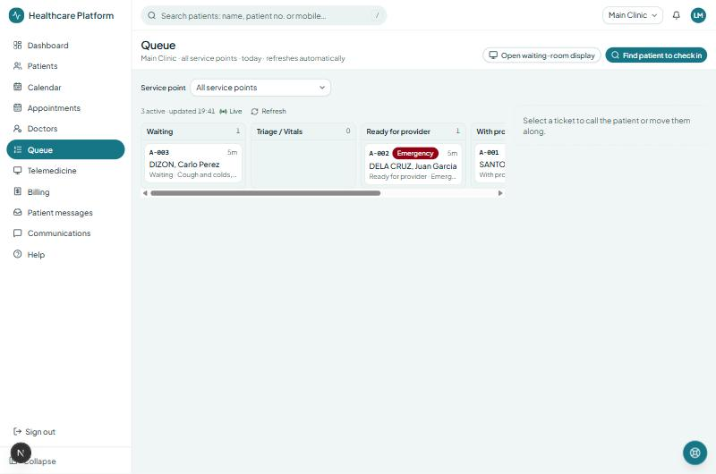
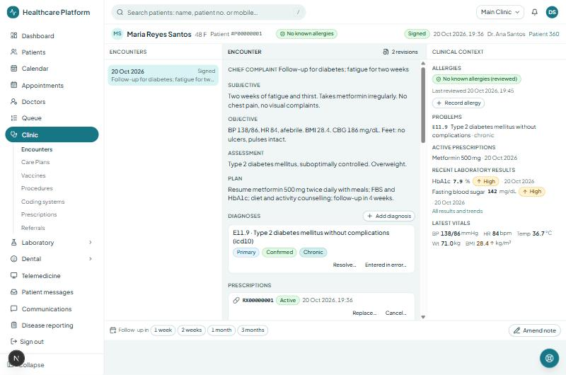
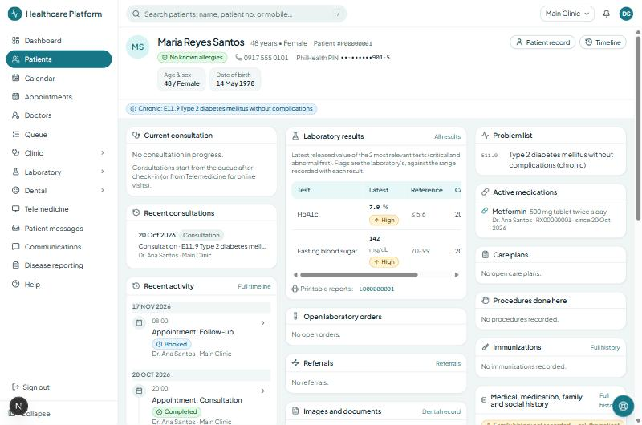
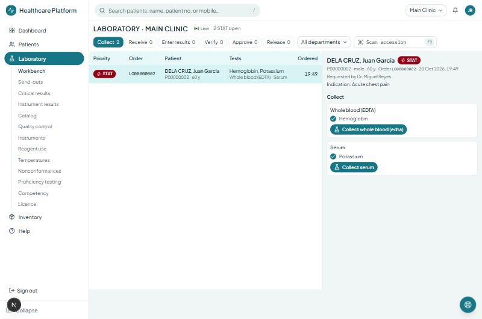
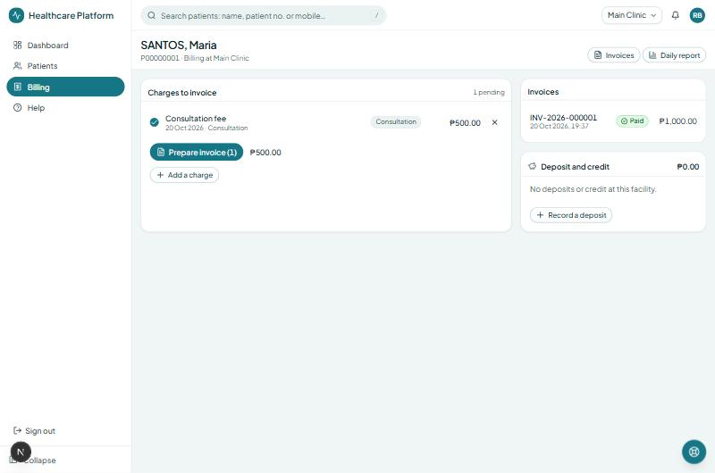
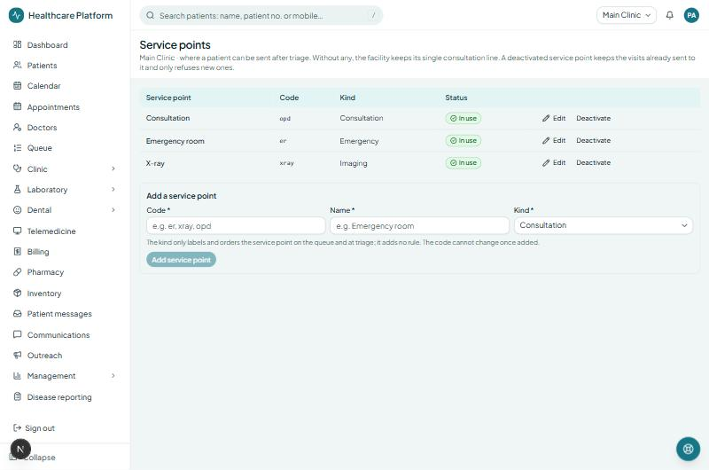

# Demo walkthrough

A guided tour of the web app for a clinic or LGU hospital audience, on the demo data that `pnpm db:seed:demo` creates.
Twenty minutes covers the front desk, triage, the doctor, the laboratory, the cashier, MyHealth and administration; each
part stands alone if the audience is one role. Screenshots below come from a local run of the demo data (`docs/demo/screenshots`).

## Set-up (once)

```bash
pnpm dev:deps            # PostgreSQL, Redis, object storage, Mailpit, LiveKit in Docker
pnpm db:migrate
pnpm db:seed             # the organization, Main Clinic and the administrator (SEED_* in .env)
pnpm dev                 # API :3333, workers, staff app :3000, MyHealth :3001
pnpm db:seed:demo        # in another terminal, once the API answers
```

`pnpm db:seed:demo` drives the public API as the administrator and the demo staff, so every rule, audit event and
domain event applies as in use. It is safe to run again (what exists is reused; today's queue and appointments are
added only when missing). It prints the accounts at the end. `DEMO_PASSWORD` changes the password of every demo
account (default `Demo-Clinic-2026`); `DEMO_EMAIL_DOMAIN` the addresses (default `demo.healthcare.ph`).

| Role                 | Sign in as                        | Shows                                                                    |
| -------------------- | --------------------------------- | ------------------------------------------------------------------------ |
| Receptionist         | `reception@demo.healthcare.ph`    | Dashboard, patients, appointments, check-in, queue, waiting-room display |
| Nurse                | `nurse@demo.healthcare.ph`        | Triage and vital signs, allergies, service points                        |
| Physician            | `dr.santos@demo.healthcare.ph`    | Encounter workspace, Patient 360, prescriptions, lab orders, referrals   |
| Physician            | `dr.reyes@demo.healthcare.ph`     | A second schedule and calendar                                           |
| Medical technologist | `medtech@demo.healthcare.ph`      | Laboratory worklist, specimens, result entry                             |
| Pathologist          | `pathologist@demo.healthcare.ph`  | Verification, approval, critical values, quality                         |
| Cashier              | `cashier@demo.healthcare.ph`      | Charges, invoices, discounts, payments, daily report                     |
| Records officer      | `records@demo.healthcare.ph`      | Records requests, retention, imports                                     |
| Pharmacist           | `pharmacist@demo.healthcare.ph`   | Dispensing from prescriptions                                            |
| Administrator        | `SEED_ADMIN_EMAIL` from `.env`    | Users, roles, facilities, service points, data privacy, compliance       |
| Patient (MyHealth)   | `maria.santos@demo.healthcare.ph` | Visits, results, prescriptions, bills, documents, consents               |

All demo accounts use the demo password. The organization code is `SEED_ORG_CODE`; MyHealth serves the organization in
`PORTAL_ORGANIZATION_CODE`, so set both to the same code (`demo` by default) before starting the apps, or Maria cannot sign in.

## What the data holds

- **Main Clinic** with two physicians on Monday–Friday schedules (08:00–12:00 and 13:00–17:00, 20-minute slots, one
  room each), three visit types (Consultation, Follow-up, Online consultation — all open to online booking), rooms, an
  ICD-10 coding system, and three **service points**: Consultation, Emergency room, X-ray.
- A laboratory with Clinical Chemistry and Hematology, five tests with reference ranges (FBS, HbA1c, creatinine,
  potassium, hemoglobin), a "Diabetes monitoring" panel, and a facility policy that lets a lone medical technologist
  verify their own entries while the pathologist approves (results release on approval).
- Billing services priced for each visit type and test, PhilHealth and an HMO as payers, a senior-citizen discount rule.
- Ten patients with Philippine names, mobile numbers, Metro Manila addresses, some PhilHealth PINs; consents recorded;
  one documented penicillin allergy (Juan Dela Cruz); two "no known allergies" reviews.
- **Today**: three appointments with Dr. Santos (Maria Santos checked in and seen; two booked), appointments on the
  next days with both doctors, a walk-in with chest pain triaged as an emergency and sent to the **Emergency room**
  service point, a walk-in with a cough still waiting. Maria Santos's consultation is signed: SOAP note, diagnosis
  E11.9, a metformin prescription, FBS and HbA1c ordered, collected, entered, verified, approved and **released**;
  a follow-up booked in four weeks; the invoice for the tests issued and paid in cash, and the consultation fee waiting
  to be invoiced. The emergency-room patient's consultation is open with Dr. Reyes: a note and a **STAT** potassium and
  hemoglobin order waiting on the laboratory worklist.
- A MyHealth account for Maria Santos.

## The tour

### 1. Front desk (receptionist, 5 minutes)

1. **Dashboard** (`/`): today's figures, what needs attention, next patients, provider workload and the live queue for
   Main Clinic.

   

2. **Patients**: the list A–Z, then search "dela cruz" and by mobile `0918 555 0102`; open **360** on a patient; show
   **Register patient** and the duplicate check (register a second "Juan Dela Cruz" born 1965-11-02 and watch the
   possible duplicates).

   

3. **Appointments**: the day schedule, **Check in** a booked patient (they appear on the queue with a ticket), **Move**
   with a reason, **Online booking** rules, the waiting list; **Calendar** for the week.

   

4. **Queue**: the board by service point (switch to **Emergency room**), select a ticket, **Call patient to** "Room 1",
   then **Open waiting-room display** in another window to show "A-003 → Room 1".

   

### 2. Triage (nurse, 3 minutes)

1. On **Queue**, select the waiting ticket (Carlo Dizon) and **Triage & vitals**: the allergy banner, previous vitals,
   priority, vital signs with plausibility checks (type 368 as the temperature to show the refusal), **Send to**
   Consultation / Emergency room / X-ray, then **Complete triage — ready for provider**.
2. Back on the queue, the ticket moves to **Ready for provider** at the chosen service point; every move is in the
   visit's routing history and the audit trail.

### 3. The doctor (physician, 5 minutes)

1. **Clinic → Consultations**: today's list; open Maria Santos's signed consultation: the SOAP note with its revision
   history, the diagnosis, the prescription (drug–allergy decision support: try prescribing penicillin to Juan Dela
   Cruz from a new consultation to see the warning and the audited override), the laboratory order with **released
   results and trends**, **Medical certificates**, **Referrals**, follow-up booking and care plans.

   

2. **Patient 360** (from the banner): allergies, problem list, active medications, results with trends, open orders,
   documents and the timeline on one screen.

   

3. As Dr. Reyes, open the emergency-room patient's consultation (Juan Dela Cruz) from **Consultations**: the note and
   the STAT order are there; add a diagnosis, then sign once the results are back — the visit closes on the queue.

### 4. The laboratory (medical technologist and pathologist, 4 minutes)

1. **Laboratory → Worklist** as the medical technologist: the STAT order under **Collect**; print the tube label,
   collect, receive, enter results (enter a potassium of 6.8 to show a **critical value**), verify.

   

2. As the pathologist: approve; the critical value appears under **Critical results** for communication and
   acknowledgement; the result reaches the doctor and, once releasable, the patient in MyHealth. **Catalog** shows
   tests, versioned reference ranges and the facility policy; **QC** the Levey-Jennings chart.

### 5. The cashier (3 minutes)

1. **Billing**: the cashier's desk; open Maria Santos's account — the invoice for the tests, paid in cash (with its
   receipt), and the consultation fee captured when the doctor signed, waiting under **Charges to invoice**: prepare
   the invoice, issue it, take the payment.

   

2. For Jose Garcia (born 1950): capture a consultation charge, create an invoice, apply the **senior-citizen discount**
   (evidence required), add PhilHealth coverage, issue, take a partial payment; show the **daily report**.

### 6. MyHealth (patient, 3 minutes)

Sign in at `http://localhost:3001` as Maria Santos: visits and the follow-up, **released results** in plain language with
trends, active prescriptions, bills with the paid invoice, **Documents** (ask the records office for copies or a
correction), **Privacy and consents**, notification settings and two-step verification; book or move an appointment
within the clinic's published schedule.

### 7. Administration (administrator, 3 minutes)

**Administration**: staff users and roles by scope, facilities, **Service points**, **Data privacy** (the breach
register and the organization's own notification window), **Compliance** (who validated each area), **Audit log**
(every view and change above, by person, patient and record), **Help** with its searchable manual.



## Resetting

The demo data lives in the ordinary database. To start over, recreate it:

```bash
pnpm db:migrate   # after dropping and recreating the database named in DATABASE_URL
pnpm db:seed
pnpm db:seed:demo
```

## A hosted demo

The same steps run against any deployment: run `pnpm db:seed:demo` with `API_BASE_URL` pointing at the deployed API and
`SEED_ADMIN_*` set to its administrator. See `docs/deployment/railway.md` for a Railway project (API, workers, staff app,
MyHealth, PostgreSQL, Redis, object storage) and `docs/demo/hosted-demo.md` for the demo environment's checklist.
